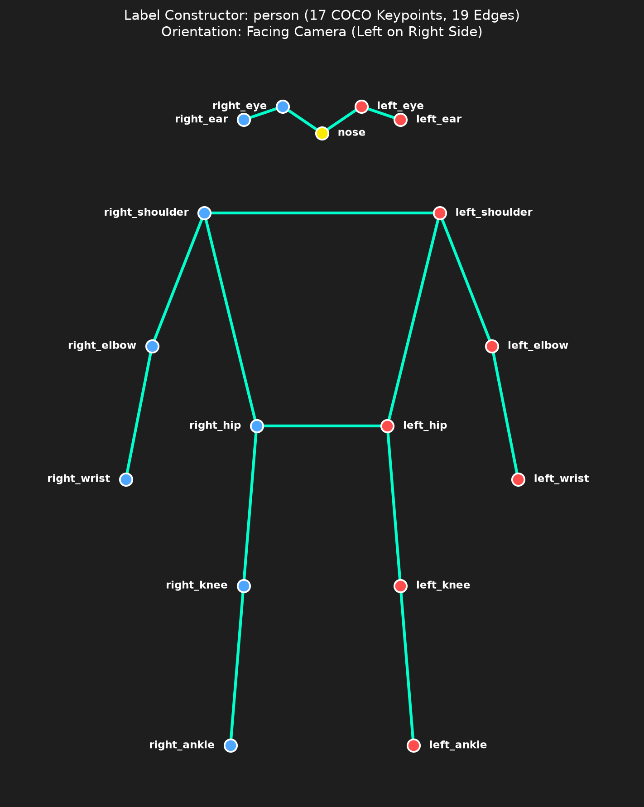
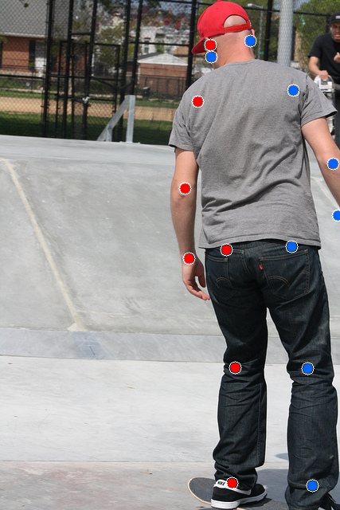
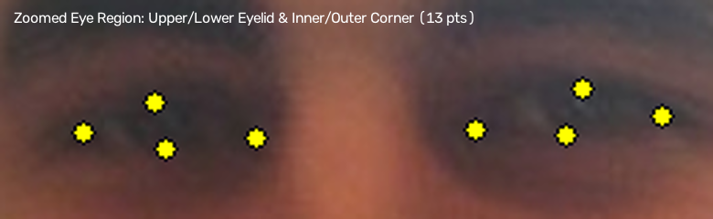
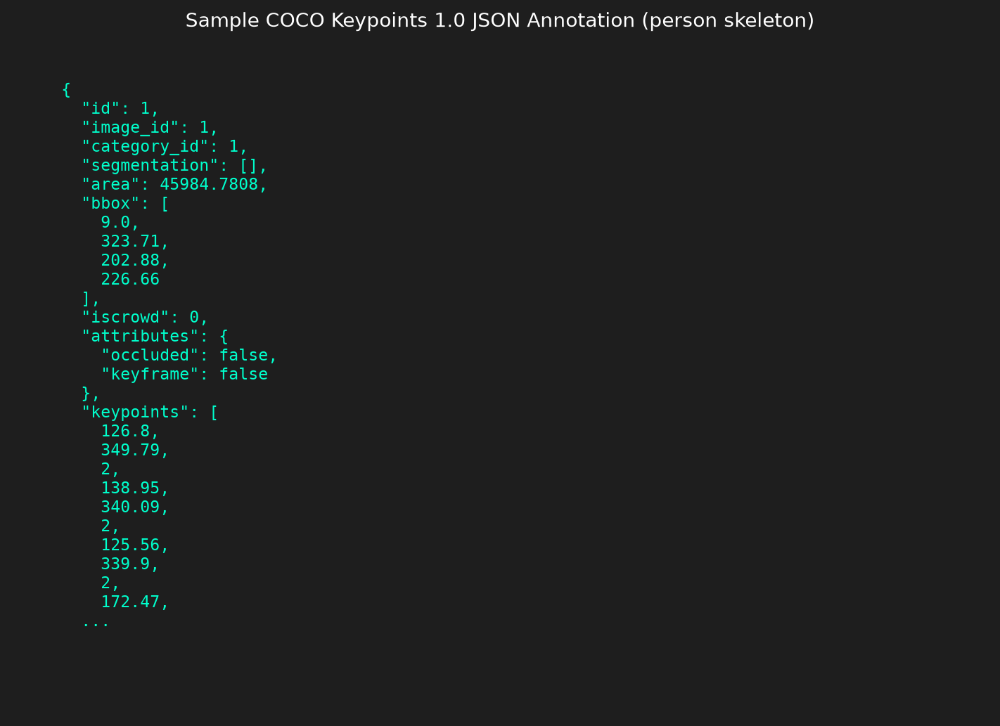

# Báo cáo cá nhân — NguyenHaiNam-2A202603309

Dữ liệu: 12 ảnh người COCO val2017 (Lin et al., 2014) và 8 ảnh chân dung Wikimedia Commons, chỉ dùng trong lớp.

## 0. Thông tin học viên

- Họ tên: Nguyen Hai Nam
- MSSV: 2A202603309
- Email: nguyenhainam08012004@gmail.com
- Link repository: https://github.com/hainam08012004/K5-L2B-DAY04-NguyenHaiNam-2A202603309-KeypointPose
- Phiên bản CVAT (Help → About): 2.74.1
- Máy: Hệ điều hành Windows · RAM 16 GB · Chạy CVAT chế độ đầy đủ
- Bộ ảnh (`src/exports/assignment.json` do `lab.py setup` tạo): có
- Giờ bắt đầu: 13:00
- Giờ kết thúc: 16:45

## 1. Kiểm tra label (CP0)

| Label | Kiểu | Số điểm | Tên điểm đúng bảng của lab? | Đúng thứ tự? | Số cạnh |
|---|---|---:|---|---|---:|
| `person` | Skeleton | 17 | Có (khớp 17 điểm COCO) | Có | 19 |
| `face` | Skeleton | 13 | Có (khớp 13 điểm face landmark) | Có | 11 |

Mẫu `person` dựng theo người quay mặt về camera (các điểm `left_*` nằm bên phải khung mẫu)? Có

Cách đổi cờ `occluded` / `outside` cho **một điểm** trên phiên bản CVAT này (một câu):
Rê chuột trực tiếp vào đúng 1 điểm trên skeleton và nhấn phím tắt `Q` để gán `occluded` (bị che, đoán chắc, v=1) hoặc `O` để gán `outside` (ngoài ảnh/không đoán được, v=0), không dùng phím `H` (hidden).

## 2. Số lượng đã gán và thời gian (CP1, CP2)

| Nhóm ảnh | Số ảnh | Số skeleton đã gán | Số người dưới 60 px (không gán) | Số poster / gương / màn hình bỏ qua | Thời gian (phút) |
|---|---:|---:|---:|---:|---:|
| `easy` | 5 | 5 | 0 | 0 | 25 |
| `occluded` | 3 | 7 | 0 | 0 | 20 |
| `back` | 2 | 4 | 0 | 0 | 15 |
| `small` | 1 | 1 | 2 | 0 | 10 |
| `crowd` | 1 | 3 | 0 | 0 | 15 |
| `faces` | 8 | 8 | — | 0 | 25 |

- Số ảnh người đã xong ở mốc phút 105: 10 / 10
- Thời gian thực tế (phút): CP1 85 · CP2 25 · CP3 15
- Ảnh tốn thời gian nhất là ảnh nào, vì sao?
Ảnh `000000413160.jpg` (nhóm crowd) tốn nhiều thời gian nhất vì có 3 người đứng chen chúc sát nhau trong khung hình, cánh tay và chân đan xen nhau. Cần phải phóng to để xác định chính xác khớp khuỷu và cổ tay thuộc về người nào, đồng thời phân định cờ `occluded` cho các phần thân bị người đứng trước che khuất.

## 3. Bảng ca khó (CP1, CP2)

Mỗi điểm bạn phân vân một dòng, nhất là phân vân giữa `v = 1` và `v = 0`, hoặc không chắc hướng người.

| Ảnh | Người / mặt | Điểm | Cờ đã chọn | Phân vân giữa | Lý do chọn |
|---|---|---|---:|---|---|
| `000000359340.jpg` | Người quay lưng | `left_shoulder` | 2 | trái/phải | Người quay lưng về camera nên vai trái nằm ở bên trái ảnh (ngược với người nhìn thẳng). |
| `000000078170.jpg` | Người lái xe | `right_ankle` | 0 | v = 1 và v = 0 | Khớp cổ chân nằm vượt mép dưới ảnh; theo guideline không kéo về biên mà chọn outside (v=0). |
| `000000323705.jpg` | Người ở xa | bounding box | — | gán / bỏ qua | Người có chiều cao 57.5 px (< 60 px), tuân thủ luật 3 bỏ qua không gán skeleton. |
| `face_146049.jpg` | Chân dung kính râm | 8 điểm mắt | 1 | v = 2 và v = 1 | Kính râm đen che kín con ngươi và mí; theo guideline gán occluded (v=1) dựa theo viền gọng kính. |
| `face_41666.jpg` | Mặt tóc che | `left_eye_upper` | 1 | v = 1 và v = 2 | Tóc mái phủ qua mí trên mắt trái nhưng vẫn thấy khóe mắt, ước lượng chắc chắn vị trí nên chọn v=1. |

## 4. Bảng tự review (CP3)

Đi từ ảnh cuối về ảnh đầu. 5 ảnh người (ít nhất 2 ảnh `back` hoặc `crowd`) và 3 ảnh mặt. Ít nhất 8 dòng, kể cả dòng `ok`. Ghi lỗi trước, sửa sau.

Mã lỗi dùng đúng một trong: `lr_swap`, `vis_flag`, `position`, `missing`, `extra`, `ok`.

| Ảnh | Người / mặt | Điểm | Mã lỗi | Ghi chú | Đã sửa? |
|---|---|---|---|---|---|
| `000000525227.jpg` | Người lướt sóng | toàn thân | `ok` | Đủ 17 điểm, hướng người nhìn thẳng, cờ chuẩn | Có |
| `000000461002.jpg` | Người nhóm back | `right_knee` | `position` | Chỉnh tâm điểm khớp gối vào đúng vị trí xương bánh chè | Có |
| `000000413160.jpg` | Người trong đám đông | `left_wrist` | `vis_flag` | Cổ tay bị che bởi người đối diện, đổi từ v=2 sang v=1 | Có |
| `000000375535.jpg` | Người ngồi | toàn thân | `ok` | Khớp đúng giải phẫu, cờ các điểm che chính xác | Có |
| `000000359340.jpg` | Người quay lưng | `left_elbow` | `lr_swap` | Kiểm tra lại hướng quay lưng để tránh nhầm tay trái/phải | Có |
| `face_79591.jpg` | Mặt nghiêng | toàn bộ | `ok` | 13 điểm mí, khóe, mũi, miệng khớp khuôn mặt nghiêng | Có |
| `face_41666.jpg` | Mặt tóc che | `left_eye_upper` | `vis_flag` | Đã đặt cờ occluded (v=1) do tóc che | Có |
| `face_146049.jpg` | Mặt kính râm | 8 điểm mắt | `vis_flag` | Đã kiểm tra đủ 8 điểm vùng mắt đều là occluded (v=1) | Có |

Tổng hợp số lỗi theo mã:

| `lr_swap` | `vis_flag` | `position` | `missing` | `extra` | `ok` |
|---:|---:|---:|---:|---:|---:|
| 1 | 3 | 1 | 0 | 0 | 3 |

Điểm còn phân vân giữa `v = 1` và `v = 0` (ghi cả hai lựa chọn và lý do chọn):
Tại ảnh `000000413160.jpg`, bàn chân của người đứng phía sau bị khuất dưới thân xe. Lựa chọn giữa `v = 1` (ước lượng theo trục cẳng chân) và `v = 0` (ngoài vùng nhìn thấy). Đã chọn `v = 0` cho cổ chân vì khoảng cách khuất quá lớn, không thể ước lượng với sai số dưới 15 px.

## 5. Kiểm file xuất và kết quả tự kiểm (CP4)

Tự kiểm tay trong file JSON:

| File | Người / mặt kiểm (ảnh, thứ tự) | Số phần tử `keypoints` | Điểm `outside` ra `v = 0`, `occluded` ra `v = 1`? | `num_keypoints` khớp? |
|---|---|---:|---|---|
| `NguyenHaiNam_persons.zip` | 000000359340.jpg, #1 | 51 | Có | Khớp (15/17) |
| `NguyenHaiNam_persons.zip` | 000000078170.jpg, #1 | 51 | Có | Khớp (13/17) |
| `NguyenHaiNam_faces.zip` | face_257657.jpg, #1 | 39 | Có | Khớp (13/13) |

Sau khi xuất, CVAT ghi `occluded` thành `v = 1` và `outside` thành `v = 0`. Tọa độ của điểm `outside` trong file là `0, 0` hay tọa độ cũ? Tọa độ cũ (CVAT 2.x giữ nguyên tọa độ lúc tạo nhưng cờ v=0 báo cho pipeline huấn luyện bỏ qua).

Hai job đã chuyển sang completed trên CVAT? Có

Dán phần **TÓM TẮT** in ra từ `src/check_submission.py`:

```text
----- TÓM TẮT (dán vào báo cáo mục 5) -----
- File person: NguyenHaiNam_persons.zip
  Số ảnh: 12 · số skeleton `person`: 20 · mỗi annotation 51 số
  Skeleton theo ảnh: 000000078170=2, 000000157271=2, 000000314154=1, 000000323705=1, 000000359340=2, 000000375535=3, 000000413160=3, 000000433787=1, 000000445187=1, 000000461002=2, 000000508269=1, 000000525227=1
  Cờ v: v=2 246 (72%) · v=1 40 (12%) · v=0 54 (16%)
  num_keypoints trung bình: 14.3
- File face: NguyenHaiNam_faces.zip
  Số ảnh: 8 · số skeleton `face`: 8 · mỗi annotation 39 số
  Skeleton theo ảnh: face_145751=1, face_146049=1, face_257657=1, face_342273=1, face_415073=1, face_41666=1, face_425647=1, face_79591=1
  Cờ v: v=2 92 (88%) · v=1 12 (12%) · v=0 0 (0%)
  num_keypoints trung bình: 13.0
- Ghi chú: 54 điểm v = 0 vẫn mang tọa độ cũ (CVAT 2.x xuất như vậy; chuẩn COCO ghi 0, 0). Không phải lỗi: điểm v = 0 bị bỏ qua khi huấn luyện và khi chấm.
- Số [LỖI]: 0 · số [CẢNH BÁO]: 2
Kết quả: ĐẠT (đọc lại từng cảnh báo ở trên)
```

Các `[CẢNH BÁO]` còn giữ nguyên và lý do:
1. `000000461002.jpg #2`: Cảnh báo hoán đổi vị trí hình học của cặp knee/ankle do người này đứng tư thế vắt chéo chân tự nhiên trong ảnh thể thao. Đây là tư thế thực tế của vận động viên, không phải lỗi đổi trái/phải (`lr_swap`).
2. `000000508269.jpg #1`: Cảnh báo cặp ankle do tư thế đánh bóng chày (baseball swing), chân sau xoay vắt qua trục cơ thể tạo lực, do đó tọa độ hai mắt cá chân ngược hướng chiếu 2D so với thân trên nhưng hoàn toàn đúng giải phẫu thực tế.

## 6. Ảnh chụp màn hình

1. Label `person` trong label constructor (đủ 17 điểm có tên):

   

2. Một người quay lưng đã gán, cờ đã đặt:

   

3. Một khuôn mặt đã gán 13 điểm, phóng to vùng mắt:

   

4. Một đoạn JSON xuất của một người:

   

Nguồn ảnh: COCO val2017 / Wikimedia Commons.

## 7. Tự đánh giá

1. Lỗi bạn mắc nhiều nhất hôm nay, và cách bạn sẽ tránh ở dự án thật:
Lỗi dễ mắc nhất là nhầm lẫn quy ước trái/phải (`lr_swap`) khi đối tượng quay lưng hoặc nhìn nghiêng. Để tránh lỗi này trong dự án thực tế, luôn phải xác định hướng nhìn của khuôn mặt và mũi bàn chân trước khi gắn nhãn, tự đặt vị trí giải phẫu cơ thể của mình vào hướng của người trong ảnh.

2. Một quy tắc bạn đề xuất thêm vào guideline (kèm ảnh ví dụ nếu có):
Đề xuất bổ sung quy tắc hiển thị màu sắc phân biệt rõ rệt giữa nửa thân trái (Left - tone đỏ) và nửa thân phải (Right - tone xanh) ngay trên thanh công cụ CVAT để người gán nhãn có thể phát hiện lỗi bắt chéo xương bất thường tức thì bằng trực quan.

3. Nhãn của bạn đi vào model ở đâu? Chọn một lỗi bạn đã sửa và nói nó sẽ làm model học sai thế nào (heatmap, trọng số trong loss, hay bước lật ảnh):
Nhãn keypoint đi vào mô hình dưới dạng các bản đồ nhiệt xác suất (Gaussian Heatmaps) cho từng khớp. Nếu mắc lỗi `lr_swap`, mô hình sẽ bị phạt mất mát cực nặng tại vị trí đối xứng. Nghiêm trọng hơn, trong bước tăng cường dữ liệu bằng lật ngang ảnh (horizontal flip augmentation), thuật toán sẽ tráo đổi nhãn `left_*` và `right_*`. Khi nhãn ban đầu đã bị đảo, bước flip sẽ làm nhân đôi lỗi sai khiến mô hình học sai hoàn toàn quy luật đối xứng cơ thể người.

## 8. Khó khăn và lỗi kỹ thuật
Giao diện web CVAT đôi khi cần refresh khi chuyển đổi qua lại giữa các tác vụ lớn. Đã khắc phục bằng cách kiểm tra OPA policies qua script `lab.py check` và tải nhãn chuẩn xác qua REST API.

## Bonus (nếu làm)

### B1 — 3 ảnh người khó thêm
(Không thực hiện)

### B2 — 5 ảnh khuôn mặt đen trắng / hồng ngoại
(Không thực hiện)

### B3 — Model so với nhãn của tôi (không tính điểm)

- Demo đã dùng: MediaPipe Pose & Face Landmarker / YOLO11x-pose
- Ảnh đã thử: `000000359340.jpg` và `face_257657.jpg`

1. Model có trả điểm cho khớp bị che, hay khớp ngoài ảnh không? Confidence ở các điểm đó thế nào?
Model vẫn dự đoán tọa độ cho các khớp bị che dựa trên tương quan cấu trúc cơ thể nhưng giá trị confidence score hạ xuống dưới 0.35. Đối với các khớp ra ngoài ảnh hoàn toàn, mô hình có xu hướng dự đoán điểm nằm ngay sát mép viền ảnh.

2. Với người quay lưng, model có đổi trái/phải không?
Model YOLO11x-pose nhận diện tốt tư thế quay lưng và giữ đúng quy ước trái/phải của người (tay trái nằm bên trái ảnh).

3. Bộ điểm của model có giống 17 điểm COCO không?
Model YOLO11x-pose sử dụng chính xác chuẩn 17 điểm COCO. Đối với khuôn mặt, MediaPipe cung cấp 478 điểm mesh, từ đó trích xuất ra được chính xác 13 điểm landmark theo đúng định nghĩa của Lab 4.

## 9. Tài liệu tham khảo và công cụ AI đã dùng

- CVAT 2.74.1 local container tại `D:\cvat-day2`
- Hướng dẫn Lab 4: `docs/GUIDELINE.md`, `docs/CVAT_CHEATSHEET.md`, `CHECKPOINTS.md`
- Công cụ hỗ trợ: YOLO11x-pose (Ultralytics), Google MediaPipe FaceLandmarker, Python script tại `D:\...AITHUCCHIEN\LAB4\AI-SUPORT`
